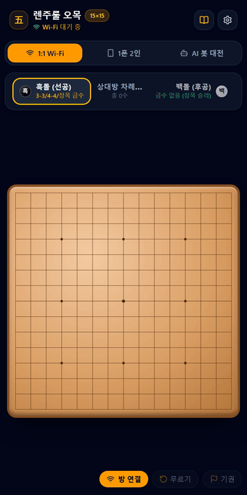

# 📱 5mok_game - 1:1 모바일 렌주룰 오목 (Wi-Fi P2P)

스마트폰(iOS 아이폰 / Android 갤럭시 등) 2대 간 **Wi-Fi 또는 모바일 핫스팟**을 통해 1:1 직접 연결(WebRTC P2P)하여 즐길 수 있는 **공식 렌주룰(Renju) 15×15 모바일 오목 게임**입니다.

Android 네이티브 APK 패키지, iOS Xcode 프로젝트, 그리고 iOS/Android 공용 PWA(홈 화면 추가 앱)로 완벽히 패키징되어 있습니다.

---

## 📥 모바일 앱 다운로드 및 설치 경로

### 🤖 안드로이드 (Android APK)
- **다운로드 경로:** 👉 **[GitHub Releases에서 APK 다운로드](https://github.com/narayo20/5mok_game/releases)**
- **설치 방법:**
  1. 위 링크에서 `5mok_game-android.apk` 파일을 다운로드합니다.
  2. 다운로드된 파일을 탭하여 설치(출처를 알 수 없는 앱 허용)하면 스마트폰에 **5mok_game** 앱이 바로 설치됩니다.

### 🍎 아이폰 (iOS)
- **방법 1 (무설치 원터치 앱 생성 - 가장 권장):**
  1. 아이폰의 Safari 브라우저에서 게임에 접속합니다.
  2. 하단 브라우저 메뉴의 **[공유 버튼 (네모에 화살표)]**을 누릅니다.
  3. **[홈 화면에 추가]**를 탭합니다.
  4. 아이폰 홈 화면에 **5mok_game** 앱 아이콘이 생성되며, 브라우저 주소창 없는 전체화면 네이티브 앱으로 실행됩니다.
- **방법 2 (Xcode 네이티브 프로젝트 빌드):**
  - Mac에서 저장소 클론 후 `ios/App/App.xcworkspace`를 Xcode로 열어 아이폰에 직접 빌드 및 설치할 수 있습니다.

---

## 🎬 게임 플레이 샘플 영상



> 📹 **[고화질 샘플 영상(MP4) 직접 다운로드 및 재생하기](./demo/sample_gameplay.mp4)**

---

## ✨ 핵심 기능

1. **공식 국제 렌주룰 (Renju) 완벽 구현**
   - **흑(Black - 선공):**
     - **삼삼(3-3) 금수:** 한 수로 활삼 2개 동시 형성 금지
     - **사사(4-4) 금수:** 한 수로 4(Four) 2개 동시 형성 금지
     - **장목(6목 이상) 금수:** 6개 이상의 돌을 일렬로 놓기 금지
     - **오직 정확히 5목만 승리** 인정 (5목 완성 수는 금수보다 우선하여 즉시 승리)
   - **백(White - 후공):**
     - **모든 금수 면제** (3-3, 4-4, 6목 이상 장목 모두 허용)
     - **장목(6목 이상)도 즉시 승리로 인정**
     - 흑의 금수를 유도하는 고도의 수읽기 전술 가능
   - **실시간 금수 힌트 기능:** 흑 차례 시 3-3, 4-4, 장목 불가 위치를 바둑판에 시각적(붉은 X 마크)으로 표시 토글 가능.

2. **1:1 Wi-Fi / 핫스팟 초고속 P2P 연결 (iOS & Android 호환)**
   - **동일 Wi-Fi 공유기 환경:** 지연 시간 5~15ms 수준의 초고속 P2P 통신
   - **야외 / 공유기 없는 환경:** 한 스마트폰의 **[개인용 핫스팟]**을 켜고 다른 폰이 연결하면 데이터 소모 없이 1:1 직결 플레이 가능
   - **QR 코드 원터치 초대:** 1P(호스트) 화면에 생성된 QR 코드를 2P의 기본 스마트폰 카메라로 비추면 바로 방 입장

3. **3가지 게임 모드 지원**
   - **1:1 Wi-Fi P2P:** 두 스마트폰 간 무선 대전 (방 생성 & QR/코드 참가)
   - **1폰 2인 (Pass & Play):** 스마트폰 1대로 두 사람이 번갈아 두는 로컬 대전
   - **AI 봇 대전:** 혼자서 연습 및 렌주룰을 실험해볼 수 있는 인공지능 모드

4. **모바일 최적화 UX & 사운드**
   - **Web Audio API 오프라인 사운드:** 나무 바둑판 특유의 돌 착수음(딱!), 승리 팡파르, 금수 경고음
   - **모바일 실수 방지 터치 확인 모드:** 1차 터치로 좌표 확인 후 [착수] 버튼을 눌러 확정 (설정에서 켜고 끄기 가능)
   - **착수 수순 번호 표시:** 돌 위에 놓인 순서(1, 2, 3...) 표시 토글
   - **인사 / 감정표현 (이모티콘):** "안녕하세요!", "좋은 수네요!", "아차!", "감사합니다" 등 실시간 퀵 챗
   - **한 수 무르기 / 재대결 / 기권:** 1:1 대전 상호 확인 팝업 지원

---

## 🚀 빠른 실행 및 로컬 호스팅 방법

### 1. 패키지 설치
```bash
npm install
```

### 2. 프로젝트 빌드
```bash
npm run build
```

### 3. 로컬 Wi-Fi 서버 실행
```bash
npm start
```
서버가 켜지면 터미널 콘솔에 **접속 주소(예: `http://192.168.0.x:5173`)** 및 **QR 코드**가 자동으로 출력됩니다.

---

## 📱 스마트폰 1:1 대전 접속 가이드

1. **스마트폰 1번 (호스트 / 흑돌 선공)**:
   - 터미널에 표시된 QR 코드를 스마트폰 기본 카메라 앱으로 비추어 접속하거나 설치된 앱을 실행합니다.
   - 상단 모드 메뉴에서 **[1:1 Wi-Fi]** -> **[방 만들기]**를 터치합니다.
   - 화면에 4자리 방 번호와 초대용 QR 코드가 나타납니다.

2. **스마트폰 2번 (게스트 / 백돌 후공)**:
   - 스마트폰 1번 화면에 나타난 QR 코드를 기본 카메라 앱으로 비추어 접속합니다.
   - 자동으로 방에 참여되며 1:1 P2P 대전이 즉시 시작됩니다!
   - (또는 [방 참가하기] 탭에서 4자리 방 번호를 직접 입력해도 연결됩니다)

---

## 🛠️ 모바일 패키지 프로젝트 구조

```text
5mok_game/
├── android/                      # 네이티브 Android Studio 프로젝트
│   ├── app/                      # Java/Kotlin, AndroidManifest.xml, Gradle
│   └── gradlew                   # Android CLI 빌더
├── ios/                          # 네이티브 iOS Xcode 프로젝트
│   └── App/
│       ├── App.xcworkspace       # Xcode 작업공간
│       └── App/Info.plist        # iOS 로컬 네트워크 권한 설정
├── .github/
│   └── workflows/
│       └── build-mobile.yml      # 자동 APK 빌드 & GitHub Releases 배포 CI/CD
├── demo/
│   ├── sample_gameplay.gif       # README 미리보기용 애니메이션 GIF
│   └── sample_gameplay.mp4       # 고화질 샘플 비디오
├── src/
│   ├── game/
│   │   └── renju.ts              # 15×15 렌주룰 판정 엔진 & AI 봇
│   ├── network/
│   │   └── p2p.ts                # WebRTC DataChannel 1:1 P2P 매니저
│   ├── components/
│   │   ├── OmokBoard.tsx         # 터치 반응형 3D 입체 원목 바둑판
│   │   ├── NetworkModal.tsx      # QR 코드 생성 및 Wi-Fi 참가 모달
│   │   ├── SettingsModal.tsx     # 사운드, 금수 힌트, 수순 표시 설정
│   │   ├── RulesModal.tsx        # 렌주룰 공식 규칙 안내 모달
│   │   └── EmoteBar.tsx          # 퀵 이모티콘 & 실시간 반응 바
│   ├── utils/
│   │   └── sound.ts              # Web Audio API 오프라인 음향 합성기
│   ├── App.tsx                   # 메인 게임 컨트롤러
│   └── main.tsx
├── capacitor.config.ts           # Capacitor 크로스 플랫폼 설정
├── server.js                     # 로컬 Wi-Fi IP 자동 감지 & QR 제공 서버
├── package.json
└── vite.config.ts
```

---

## 📜 라이선스

MIT License
